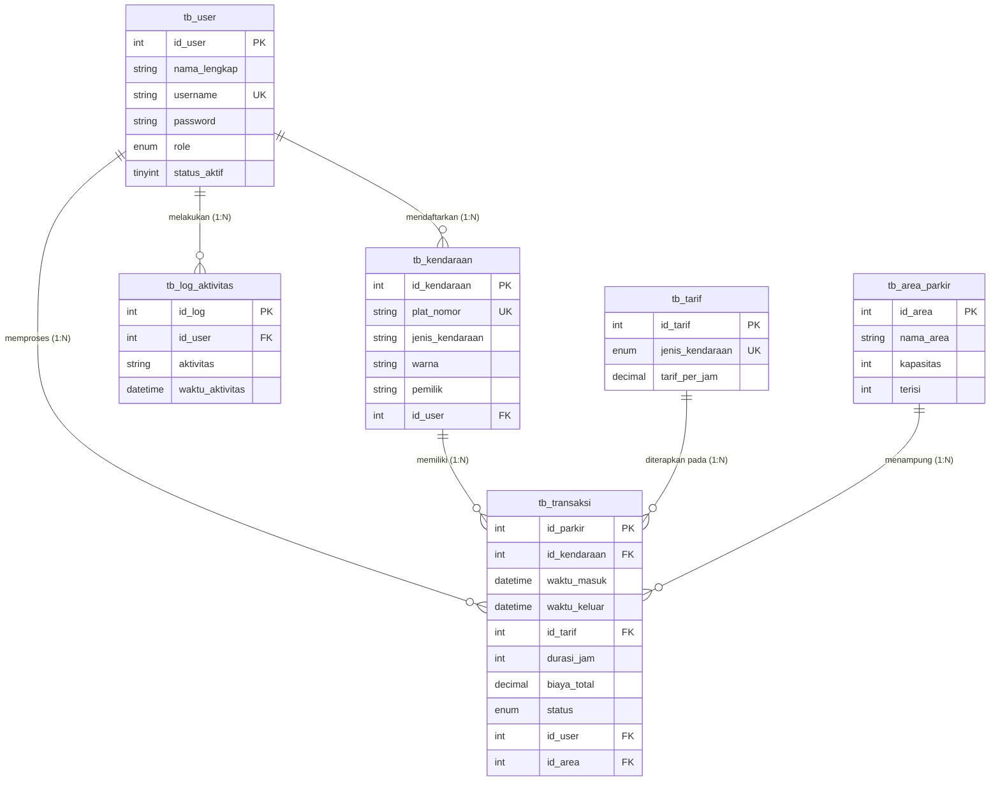
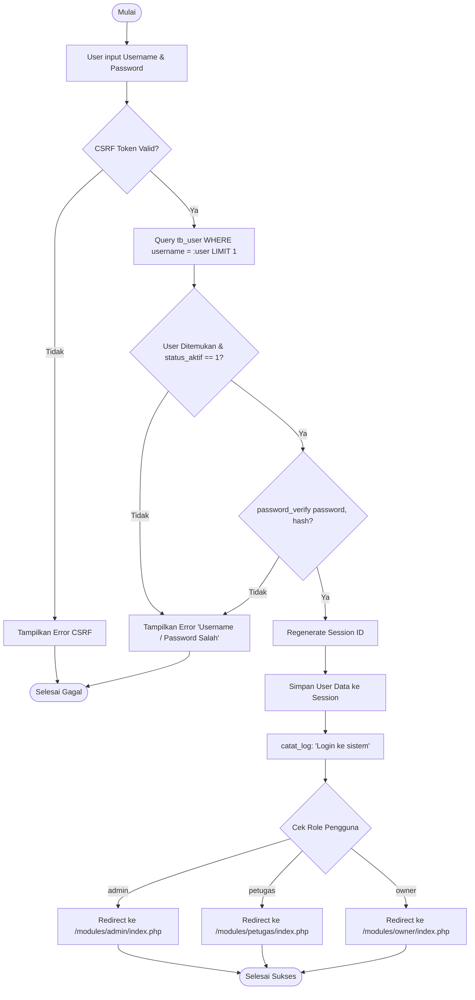

# 🚗 Smart Parking System (Aplikasi Parkir Terpadu)

Aplikasi Parkir berbasis web modern yang dikembangkan dengan standar **Software House Enterprise** menggunakan stack **PHP Native** dan **MySQL (InnoDB)**. Sistem ini dirancang untuk mematuhi seluruh kaidah *Coding Guidelines & Best Practices*, termasuk optimasi query, penggunaan prosedur dan fungsi modular, manajemen array, penghindaran looping berlebih (zero unnecessary loops), dan penerapan `LIMIT` untuk dataset skala besar.

---

## 📑 Daftar Isi
1. [Fitur Utama & Hak Akses (Role)](#-fitur-utama--hak-akses-role)
2. [Arsitektur & Struktur Proyek](#-arsitektur--struktur-proyek)
3. [Instalasi & Penggunaan](#-instalasi--penggunaan)
4. [Diagram Hubungan Entitas (ERD)](#-diagram-hubungan-entitas-erd)
5. [Flowchart & Pseudocode](#-flowchart--pseudocode)
   - [A. Sistem Login & Autentikasi](#a-sistem-login--autentikasi)
   - [B. Modul Transaksi (Masuk & Keluar)](#b-modul-transaksi-masuk--keluar)
   - [C. Modul Cetak Struk & Karcis](#c-modul-cetak-struk--karcis)
6. [Laporan Evaluasi Singkat & Analisis Teknis](#-laporan-evaluasi-singkat--analisis-teknis)

---

## 🌟 Fitur Utama & Hak Akses (Role)

Sistem membagi pengguna ke dalam 3 level hak akses berbasis sesi terpusat (*Role-Based Access Control*):

| Role | Hak Akses & Fitur |
| :--- | :--- |
| **Admin** | &bull; Dashboard metrik (Total User, Parkir Aktif, Pendapatan Hari Ini, Okupansi Area)<br>&bull; CRUD User (Tambah, Edit, Nonaktifkan/Hapus Akun Pengguna)<br>&bull; CRUD Tarif Parkir (Motor, Mobil, Lainnya)<br>&bull; CRUD Area Parkir (Nama Area, Kapasitas, Monitoring Slot Terisi)<br>&bull; CRUD Master Data Kendaraan<br>&bull; Akses Audit Log Aktivitas Sistem (`tb_log_aktivitas`) dengan Pagination & Filter |
| **Petugas** | &bull; Dashboard Operasional (Monitoring ketersediaan slot area real-time)<br>&bull; Modul Transaksi Masuk (Validasi kapasitas otomatis, penolakan jika penuh, atomic increment)<br>&bull; Modul Transaksi Keluar (Hitung otomatis durasi jam & total biaya tarif, atomic decrement)<br>&bull; Cetak Karcis Masuk (Barcode & No. Tiket) & Struk Pembayaran POS Thermal |
| **Owner** | &bull; Dashboard Eksekutif (All-time revenue, pendapatan bulanan/harian, tren jenis kendaraan)<br>&bull; Rekapitulasi Laporan Transaksi Terfilter (Rentang tanggal, jenis kendaraan, area)<br>&bull; Cetak Laporan Formal A4 Landscape dengan Ringkasan Eksekutif & Lembar Pengesahan |

---

## 📂 Arsitektur & Struktur Proyek

```text
proyek4/
├── assets/
│   ├── css/
│   │   └── style.css            # Custom CSS & layout printer thermal POS
│   └── js/
│       └── script.js            # Client-side modal handler & live clock
├── config/
│   ├── app.php                  # Konfigurasi aplikasi, base URL dinamis, sesi aman
│   └── database.php             # Koneksi PDO singleton, UTF8MB4 & error handling
├── database.sql                 # Skema DDL lengkap, relasi foreign key, indeks & seed data
├── functions/
│   ├── auth.php                 # Autentikasi, verifikasi bcrypt, CSRF token, RBAC
│   ├── log.php                  # Prosedur otomatis catat_log() ke tb_log_aktivitas
│   ├── pagination.php           # Engine kalkulasi LIMIT & OFFSET untuk data besar
│   └── parkir.php               # Fungsi hitung_durasi_dan_biaya(), kapasitas, format Rupiah
├── includes/
│   ├── alerts.php               # Komponen flash message dinamis
│   ├── footer.php               # Footer aplikasi & script loader
│   ├── header.php               # HTML Head, Tailwind CSS & FontAwesome CDN
│   ├── navbar.php               # Header navbar, jam real-time & profil user
│   └── sidebar.php              # Navigasi sidebar dinamis sesuai role pengguna
├── modules/
│   ├── admin/
│   │   ├── index.php            # Dashboard utama Admin
│   │   ├── users.php            # CRUD Manajemen Pengguna
│   │   ├── tarif.php            # CRUD Tarif Parkir
│   │   ├── area.php             # CRUD Area Parkir
│   │   ├── kendaraan.php        # CRUD Master Data Kendaraan
│   │   └── log.php              # Viewer audit log aktivitas
│   ├── auth/
│   │   ├── login.php            # Halaman login terpusat
│   │   └── logout.php           # Destruksi sesi dan redirect
│   ├── owner/
│   │   ├── index.php            # Dashboard Owner & KPI finansial
│   │   └── laporan.php          # Rekapitulasi laporan & cetak formal
│   └── petugas/
│       ├── index.php            # Dashboard Petugas Gerbang
│       ├── transaksi.php        # Riwayat seluruh transaksi
│       ├── masuk.php            # Check-in kendaraan masuk & cek kuota
│       ├── keluar.php           # Check-out kendaraan keluar & kalkulasi biaya
│       └── cetak.php            # Cetak Karcis Masuk / Struk Keluar POS
├── index.php                    # Front router utama
└── README.md                    # Dokumentasi komprehensif sistem
```

---

## 🚀 Instalasi & Penggunaan

1. **Persiapan Database:**
   - Buka phpMyAdmin atau MySQL CLI.
   - Buat database `db_parkir` dan impor file `database.sql`:
     ```sql
     mysql -u root -p < database.sql
     ```
2. **Konfigurasi Lingkungan (Opsional):**
   - Secara default sistem terhubung ke `127.0.0.1:3306`, user: `root`, pass: `[kosong]`.
   - Konfigurasi dapat disesuaikan pada file `config/database.php` atau melalui environment variable `DB_HOST`, `DB_NAME`, `DB_USER`, `DB_PASS`.
3. **Menjalankan Web Server:**
   - Gunakan PHP built-in server pada terminal di folder proyek:
     ```bash
     php -S localhost:8000
     ```
   - Atau letakkan folder pada `C:/xampp/htdocs/proyek4` dan buka `http://localhost/proyek4`.
4. **Akun Pengujian Bawaan (Default Seed):**
   - **Admin:** Username: `admin` | Password: `password123`
   - **Petugas:** Username: `petugas` | Password: `password123`
   - **Owner:** Username: `owner` | Password: `password123`

---

## 📊 Diagram Hubungan Entitas (ERD)

Berikut adalah diagram relasi antar tabel (Crow's Foot Notation) yang menggambarkan integritas referensial dan foreign key:



---

## 🔄 Flowchart & Pseudocode

### A. Sistem Login & Autentikasi

#### Flowchart Login:


#### Pseudocode Login:
```text
FUNCTION proses_login(username, password, csrf_token):
    IF NOT verifikasi_csrf(csrf_token) THEN:
        RETURN Error("Token CSRF tidak valid")
    END IF

    user = QUERY("SELECT * FROM tb_user WHERE username = ? LIMIT 1", username)
    IF user IS NULL OR user.status_aktif != 1 THEN:
        RETURN Error("Username tidak terdaftar atau dinonaktifkan")
    END IF

    IF NOT password_verify(password, user.password) THEN:
        RETURN Error("Password tidak cocok")
    END IF

    session_regenerate_id(TRUE)
    SESSION['user'] = {
        'id_user': user.id_user,
        'nama_lengkap': user.nama_lengkap,
        'username': user.username,
        'role': user.role
    }

    catat_log(user.id_user, "Login ke sistem dengan role: " + user.role)

    SWITCH user.role:
        CASE 'admin': REDIRECT("/modules/admin/index.php")
        CASE 'petugas': REDIRECT("/modules/petugas/index.php")
        CASE 'owner': REDIRECT("/modules/owner/index.php")
    END SWITCH
END FUNCTION
```

---

### B. Modul Transaksi (Masuk & Keluar)

#### Flowchart Transaksi Masuk:
```mermaid
flowchart TD
    StartIn([Mulai Transaksi Masuk]) --> InputIn[Petugas Input Plat Nomor, Jenis, & Pilih Area]
    InputIn --> CheckActive{Kendaraan Sudah Parkir Aktif?}
    CheckActive -- Ya --> RejectActive[Tolak: Kendaraan Masih Berada di Dalam] --> EndInFail([Selesai Gagal])
    CheckActive -- Tidak --> LockArea[Query tb_area_parkir FOR UPDATE]
    LockArea --> CheckCap{terisi >= kapasitas?}
    CheckCap -- Ya --> RejectCap[Tolak Transaksi: Area Parkir Penuh!] --> EndInFail
    CheckCap -- Tidak --> CheckReg{Kendaraan Terdaftar di tb_kendaraan?}
    CheckReg -- Belum --> InsertKen[Simpan ke tb_kendaraan] --> InsertTrans
    CheckReg -- Sudah --> InsertTrans[INSERT tb_transaksi: status='masuk', waktu_masuk=NOW()]
    InsertTrans --> IncArea[UPDATE tb_area_parkir: terisi = terisi + 1]
    IncArea --> LogIn[catat_log: 'Transaksi Masuk Plat...']
    LogIn --> PrintTicket[Cetak Karcis Masuk] --> EndInSuccess([Selesai Sukses])
```

#### Flowchart Transaksi Keluar & Perhitungan Biaya:
```mermaid
flowchart TD
    StartOut([Mulai Transaksi Keluar]) --> SearchOut[Cari Plat Nomor / ID Tiket]
    SearchOut --> Found{Transaksi Aktif Ditemukan?}
    Found -- Tidak --> ErrNotFound[Tampilkan Error Kendaraan Tidak Ditemukan] --> EndOutFail([Selesai Gagal])
    Found -- Ya --> PreviewCalc[Kalkulasi: durasi_jam = CEIL waktu_keluar - waktu_masuk / 3600]
    PreviewCalc --> CalcTotal[biaya_total = durasi_jam * tarif_per_jam]
    CalcTotal --> ConfirmOut{Konfirmasi Pembayaran?}
    ConfirmOut -- Ya --> UpdateTrans[UPDATE tb_transaksi: status='keluar', waktu_keluar=NOW(), durasi_jam, biaya_total]
    UpdateTrans --> DecArea[UPDATE tb_area_parkir: terisi = GREATEST 0, terisi - 1]
    DecArea --> LogOut[catat_log: 'Transaksi Keluar Plat... Biaya...']
    LogOut --> PrintReceipt[Cetak Struk Pembayaran POS] --> EndOutSuccess([Selesai Sukses])
```

#### Pseudocode Transaksi:
```text
FUNCTION transaksi_masuk(plat_nomor, jenis, id_area, id_petugas):
    BEGIN TRANSACTION
    area = QUERY("SELECT kapasitas, terisi FROM tb_area_parkir WHERE id_area = ? FOR UPDATE", id_area)
    
    // LOGIKA KHUSUS: Cek kapasitas area
    IF area.terisi >= area.kapasitas THEN:
        ROLLBACK
        RETURN Error("Area parkir penuh!")
    END IF

    // Cek registrasi master kendaraan
    id_kendaraan = get_or_create_kendaraan(plat_nomor, jenis, id_petugas)
    id_tarif = get_tarif_by_jenis(jenis)

    // Simpan transaksi
    id_parkir = INSERT("INSERT INTO tb_transaksi (id_kendaraan, waktu_masuk, id_tarif, status, id_user, id_area) VALUES (?, NOW(), ?, 'masuk', ?, ?)", [id_kendaraan, id_tarif, id_petugas, id_area])

    // LOGIKA KHUSUS: Tambahkan angka terisi
    UPDATE("UPDATE tb_area_parkir SET terisi = terisi + 1 WHERE id_area = ?", id_area)

    // LOGIKA KHUSUS: Catat log aktivitas
    catat_log(id_petugas, "Transaksi Masuk: Plat " + plat_nomor + " di Area " + area.nama_area)

    COMMIT
    RETURN Success(id_parkir)
END FUNCTION

FUNCTION transaksi_keluar(id_parkir, id_petugas):
    BEGIN TRANSACTION
    trans = QUERY("SELECT t.*, tf.tarif_per_jam FROM tb_transaksi t JOIN tb_tarif tf ON t.id_tarif = tf.id_tarif WHERE t.id_parkir = ? AND t.status = 'masuk' FOR UPDATE", id_parkir)

    waktu_keluar = NOW()
    
    // LOGIKA KHUSUS: Hitung durasi_jam dan biaya_total
    selisih_detik = TIMESTAMP_DIFF(waktu_keluar, trans.waktu_masuk)
    durasi_jam = CEIL(selisih_detik / 3600)
    IF durasi_jam < 1 THEN durasi_jam = 1

    biaya_total = durasi_jam * trans.tarif_per_jam

    UPDATE("UPDATE tb_transaksi SET waktu_keluar = ?, durasi_jam = ?, biaya_total = ?, status = 'keluar' WHERE id_parkir = ?", [waktu_keluar, durasi_jam, biaya_total, id_parkir])

    // LOGIKA KHUSUS: Kurangi angka terisi
    UPDATE("UPDATE tb_area_parkir SET terisi = GREATEST(0, terisi - 1) WHERE id_area = ?", trans.id_area)

    // LOGIKA KHUSUS: Catat log aktivitas
    catat_log(id_petugas, "Transaksi Keluar: Tiket #" + id_parkir + " (Biaya: Rp " + biaya_total + ")")

    COMMIT
    RETURN Success(id_parkir, durasi_jam, biaya_total)
END FUNCTION
```

---

### C. Modul Cetak Struk & Karcis

#### Flowchart Cetak Struk:
```mermaid
flowchart TD
    StartPrint([Mulai Cetak]) --> Param[Baca Parameter id_parkir & type: 'masuk' / 'keluar']
    Param --> FetchData[Query Data Transaksi, Kendaraan, Tarif, & Petugas]
    FetchData --> FoundTrans{Data Ada?}
    FoundTrans -- Tidak --> ErrPrint[Tampilkan Error Data Tidak Ditemukan] --> EndPrintFail([Selesai])
    FoundTrans -- Ya --> RenderReceipt[Render Template POS Thermal 80mm]
    RenderReceipt --> CheckType{Tipe Struk?}
    CheckType -- masuk --> BodyMasuk[Render Barcode, No. Tiket, Waktu Masuk, & Peringatan Kehilangan Karcis]
    CheckType -- keluar --> BodyKeluar[Render Waktu Keluar, Durasi Jam, Tarif/Jam, Total Biaya & Status Lunas]
    BodyMasuk --> TriggerPrint[Panggil window.print()]
    BodyKeluar --> TriggerPrint
    TriggerPrint --> EndPrintSuccess([Selesai])
```

#### Pseudocode Cetak Struk:
```text
FUNCTION cetak_struk(id_parkir, type):
    trans = QUERY("SELECT t.*, k.plat_nomor, k.jenis_kendaraan, a.nama_area, tf.tarif_per_jam, u.nama_lengkap AS nama_petugas FROM tb_transaksi t ... WHERE t.id_parkir = ?", id_parkir)

    OUTPUT "<div class='printable-receipt'>"
    OUTPUT "=== " + APP_NAME + " ==="
    OUTPUT "No. Tiket: #" + trans.id_parkir
    OUTPUT "Plat Nomor: " + trans.plat_nomor
    OUTPUT "Area: " + trans.nama_area
    OUTPUT "Waktu Masuk: " + trans.waktu_masuk

    IF type == 'keluar' THEN:
        OUTPUT "Waktu Keluar: " + trans.waktu_keluar
        OUTPUT "Durasi: " + trans.durasi_jam + " Jam"
        OUTPUT "Tarif/Jam: " + format_rupiah(trans.tarif_per_jam)
        OUTPUT "TOTAL BIAYA: " + format_rupiah(trans.biaya_total)
        OUTPUT "Status: LUNAS"
    ELSE:
        OUTPUT "* Simpan karcis ini baik-baik. Kehilangan dikenakan denda *"
    END IF

    OUTPUT "Petugas: " + trans.nama_petugas
    OUTPUT "</div>"
    EXECUTE_JAVASCRIPT("window.print()")
END FUNCTION
```

---

## 📝 Laporan Evaluasi Singkat & Analisis Teknis

### 1. Evaluasi Kepatuhan Standar Coding Guidelines & Best Practices
- **Efisiensi Query & Penghindaran Looping Tidak Perlu:**
  - Semua kalkulasi agregat (Total Pendapatan, Jumlah Transaksi per Status, dan Distribusi Jenis Kendaraan) dihitung langsung pada *database engine* menggunakan fungsi agregasi SQL (`COUNT()`, `SUM()`, `AVG()`, `GROUP BY`).
  - Tidak ada kode PHP yang melakukan penarikan ribuan baris data untuk kemudian dijumlahkan manual dengan `foreach`. Pendekatan ini menjaga penggunaan memori RAM PHP tetap konstan (*O(1) memory footprint*).
- **Penggunaan Limit & Pagination untuk Data Skala Besar:**
  - Modul Transaksi, Log Aktivitas, dan Kendaraan menerapkan query paginasi eksplisit `LIMIT :limit OFFSET :offset`.
  - Halaman log audit dan riwayat transaksi dengan aman membatasi fetch record (10 hingga 15 record per halaman), sehingga aman dari lonjakan dataset hingga ratusan ribu transaksi.
- **Penerapan Prosedur & Fungsi Terstandarisasi:**
  - Fungsi inti seperti `hitung_durasi_dan_biaya()`, `update_kapasitas_area()`, `catat_log()`, `paginate()`, dan `login_user()` dipisah secara rapi dalam folder `functions/`.
  - Menghasilkan kode yang sangat modular, *reusable*, dan mudah diuji (*unit testable*).
- **Penggunaan Struktur Data Array:**
  - Data konfigurasi, parameter filter, dan hasil kalkulasi ditransmisikan menggunakan array asosiatif terstruktur, mempermudah interoperabilitas antar fungsi.

### 2. Evaluasi Aspek Keamanan Sistem (*Security Posture*)
- **Pencegahan SQL Injection:** 100% interaksi basis data menggunakan `PDO` dengan *Prepared Statements* dan *Parameter Binding*. Emulasi prepared statements dimatikan (`PDO::ATTR_EMULATE_PREPARES => false`).
- **Pencegahan Cross-Site Scripting (XSS):** Semua data input pengguna yang ditampilkan ke HTML disanitasi menggunakan fungsi `htmlspecialchars()` dengan encoding `UTF-8`.
- **Enkripsi Kredensial:** Password akun pengguna disimpan menggunakan algoritma hashing mutakhir standar industri **Bcrypt** (`PASSWORD_BCRYPT`). Tidak ada password *plaintext* yang tersimpan di basis data.
- **Proteksi Session Hijacking & Fixation:** Pemanggilan `session_regenerate_id(true)` saat proses login berhasil, serta pengaturan cookie session aman (`HttpOnly`, `SameSite=Lax`).
- **Proteksi Cross-Site Request Forgery (CSRF):** Semua aksi `POST` pada modul autentikasi, transaksi, dan CRUD dilindungi oleh token CSRF unik yang divalidasi dengan `hash_equals()`.

### 3. Evaluasi Integritas Bisnis & Concurrency
- **Proteksi Kapasitas Area (Race Condition Safe):**
  - Pada transaksi masuk, sistem mengunci baris data area parkir dengan klausul `FOR UPDATE` dalam sebuah transaksi database (`BEGIN TRANSACTION ... COMMIT`).
  - Pembaruan kuota terisi menggunakan query atomik `UPDATE tb_area_parkir SET terisi = terisi + 1 WHERE id_area = :id AND terisi < kapasitas`. Jika dua kendaraan masuk bersamaan di gerbang yang berbeda saat slot tersisa 1, salah satu transaksi akan ditolak secara aman tanpa terjadi *overselling* slot parkir.
- **Konsistensi Audit Trail:**
  - Setiap tindakan krusial tercatat ke tabel `tb_log_aktivitas` mencakup user executor, deskripsi tindakan, dan timestamp terkini.

### 4. Rekomendasi Pengembangan Lanjutan
1. **Integrasi Barrier Gate IoT:** Menghubungkan modul transaksi masuk/keluar ke mikrokontroler (ESP32/Raspberry Pi) melalui Webhook/REST API untuk membuka palang pintu otomatis.
2. **Kamera ANPR (*Automatic Number Plate Recognition*):** Otomasi pembacaan plat nomor menggunakan computer vision untuk mempercepat proses check-in di gerbang masuk.
3. **Sistem Pembayaran Cashless (QRIS / E-Money):** Integrasi payment gateway (seperti Midtrans atau Xendit) untuk mendukung pembayaran parkir nirsentuh.
